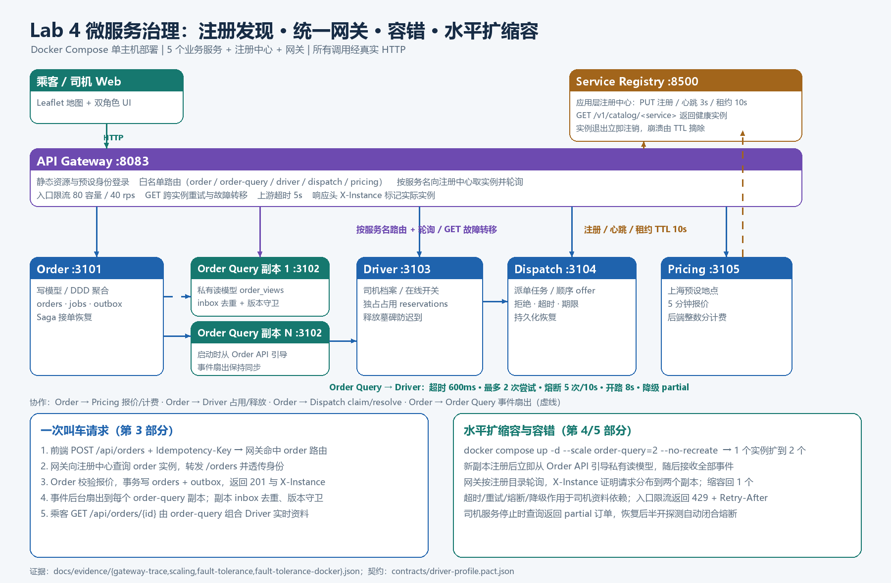

# 沪行 · 网约车微服务治理（Lab 4）

高级软件工程第 32 组 Lab 4。在 Lab 3 的网约车业务上，增加**服务注册与发现、统一 API 网关、订单查询容错、水平扩缩容与契约测试**，全部通过 **Docker Compose** 部署并实际验证。

- 默认入口：**http://localhost:8083**
- 注册中心目录：**http://localhost:8500/v1/catalog**
- 实现：Node.js 24（内置 HTTP、SQLite、test），无 npm 运行依赖
- 部署：Docker Compose，5 个业务服务 + 注册中心 + 网关，全部为独立容器
- 仓库：https://github.com/CPLASF2049/Lab4-Ride-Hailing（初始提交 e119286）



## 1. 小组与分工安排

沿用 Lab 2/3 第 32 组。下表列出本实验的分工和复核范围。

| 成员 | 学号 | 负责范围 |
| --- | --- | --- |
| 李金正 | 26113050066 | 注册中心与网关、服务发现与订单链路、查询副本就绪与读模型补齐、Compose 扩缩容读写验收、GitHub Actions 自动验证和 README 更新 |
| 李思源 | 26213050248 | 订单查询容错、契约测试、测试整理、报告与演示材料 |
| 共同核对 | — | 治理参数、验收记录、代码与报告一致性 |

## 2. 环境要求

| 依赖 | 版本 | 说明 |
| --- | --- | --- |
| Docker Desktop / Docker Engine | 24+，含 Compose v2 | 本实验实际使用 Docker Desktop 29.8、Compose 5.5.1 |
| Node.js | 24+（可选） | 仅在宿主机直接运行测试或本地调试时需要，不用于容器运行 |

镜像基于 `node:24-alpine` 构建，业务代码无第三方依赖。宿主机无需安装数据库或注册中心软件。

## 3. 一键启动

在仓库根目录执行以下命令。

```powershell
docker compose config --quiet      # 可选：校验配置
docker compose up -d --build       # 构建镜像并启动 7 个容器
docker compose ps                  # 7 个服务均为 healthy
```

首次构建需要拉取 `node:24-alpine`。启动后打开 **http://localhost:8083**。

```powershell
docker compose logs -f gateway order order-query   # 关联日志
docker compose down                                 # 停止，保留业务数据卷
docker compose down --volumes                       # 完全重置（含数据）
```

仅 `gateway:8083` 与 `registry:8500` 发布到宿主机，业务服务端口只在 Compose 网络内可见。

### 演示账号与初始数据

| 账号 | 角色 | 显示名 | 初始状态 |
| --- | --- | --- | --- |
| `rider-1` / `rider-2` | 乘客 | 陈同学 / 李同学 | 无进行中订单 |
| `driver-1` / `driver-2` | 司机 | 王师傅 / 赵师傅 | 离线、空闲 |

司机先在页面开启接单；乘客选择上海预设地点并叫车。订单、派单、司机占用等数据保存在各自命名卷中，`docker compose restart` 不丢失。

## 4. 服务、端口与注册名

| Compose 服务 | 注册名 | 容器端口 | 宿主机端口 | 职责 |
| --- | --- | --- | --- | --- |
| `registry` | `registry` | 8500 | 127.0.0.1:8500 | 应用层注册中心：注册、心跳、租约、目录查询 |
| `gateway` | `gateway` | 8083 | 127.0.0.1:8083 | 静态页面、登录、白名单路由、限流、按发现结果转发 |
| `order` | `order` | 3101 | — | 订单写模型（DDD 聚合、Saga、Outbox） |
| `order-query` | `order-query` | 3102 | — | 订单读模型、组合查询、容错与限流 |
| `driver` | `driver` | 3103 | — | 司机档案、在线状态、独占占用 |
| `dispatch` | `dispatch` | 3104 | — | 派单任务与顺序 offer |
| `pricing` | `pricing` | 3105 | — | 预设地点、报价与计费 |

`order-query` 的每个副本使用独立 SQLite。副本从 Order API 初始化读模型，持续接收订单事件，并定期补取漏掉的更新。

## 5. 注册发现与统一网关

### 注册与发现

- 每个业务进程启动后向注册中心 `PUT /v1/instances/{id}` 注册 `{service,address,port,ttl_ms}`，默认 **3 秒心跳、10 秒租约**。
- 进程收到 `SIGTERM` 时立即 `DELETE` 注销；崩溃实例由注册中心清理过期条目。
- 网关与服务调用方通过 `GET /v1/catalog/{service}` 获取健康实例，缓存 1.5 秒，轮询选择目标；读取请求在某实例连接失败时自动切换下一个实例。
- 服务间调用同样使用注册名：Order → pricing / driver / dispatch，Dispatch → driver / order，Order Query → driver / order。

查看当前目录：

```powershell
curl http://localhost:8500/v1/catalog
curl http://localhost:8083/api/system/discovery
```

### 网关路由

前端只访问 `http://localhost:8083/api/...`。网关去掉 `/api` 前缀后按白名单转发，并使用注册中心定位实例。

| 前端请求 | 目标服务 | 转发路径 |
| --- | --- | --- |
| `POST /api/orders` | order | `/orders` |
| `POST /api/orders/{id}/cancel` | order | `/orders/{id}/cancel` |
| `GET /api/orders/{id}` | order-query | `/orders/{id}`（组合司机资料） |
| `GET /api/orders/current` | order-query | `/orders/current` |
| `GET /api/drivers/me/offers` | dispatch | `/drivers/me/offers` |
| `POST /api/offers/{id}/accept` | dispatch | `/offers/{id}/accept` |
| `POST /api/orders/estimate` | pricing | `/orders/estimate` |

网关还负责：入口限流（默认每 IP 80 容量、40 rps，超限 `429 RATE_LIMITED`）、上游 5 秒超时、GET 跨实例故障转移、`X-Instance` 响应头标记实际处理实例。内部接口（`/internal/*`）不会暴露。

### 一次请求示例

```powershell
# 登录
$login = Invoke-RestMethod -Method Post http://localhost:8083/api/auth/login -ContentType 'application/json' -Body '{"account_id":"rider-1"}'
$h = @{ Authorization = "Bearer $($login.token)" }

# 获取报价
$estimate = Invoke-RestMethod -Method Post http://localhost:8083/api/orders/estimate -Headers $h -ContentType 'application/json' -Body '{"origin_id":"fudan","destination_id":"bund"}'

# 创建订单（幂等键）
$headers = $h + @{ 'Idempotency-Key' = [guid]::NewGuid().ToString() }
$order = Invoke-RestMethod -Method Post http://localhost:8083/api/orders -Headers $headers -ContentType 'application/json' -Body (@{ estimate_id = $estimate.estimate.id } | ConvertTo-Json)

# 查询订单（由 order-query 组合司机资料）
Invoke-WebRequest http://localhost:8083/api/orders/$($order.order.id) -Headers $h | Select-Object StatusCode, Headers
```

响应头 `X-Instance` 显示实际处理请求的实例，如 `order-a4e3b8b49a23-3101` 或 `order-query-7dc41aac4b7d-3102`。

## 6. 水平扩缩容

```powershell
# 1 个实例扩容到 2 个
docker compose up -d --scale order-query=2 --no-recreate
docker compose ps                       # order-query-1 / order-query-2
curl http://localhost:8500/v1/catalog/order-query

# 缩容回 1 个
docker compose up -d --scale order-query=1 --no-recreate
```

新副本加载初始快照前返回 `503 QUERY_BOOTSTRAPPING`，网关会切换到其他可用副本。Order 的 Outbox 向发现到的所有查询实例投递事件。查询副本每 2 秒按游标补取更新，弥补注册目录缓存期间可能遗漏的事件。快照和事件都只用较新的订单版本更新读模型。

11 月 26 日的 Docker Compose 验收完成了 1 → 2 → 1 扩缩容，两个副本各处理 6 次查询。11 月 27 日的本地回归覆盖了扩容期间继续查询、新建订单与取消订单。详见 [Compose 扩缩容记录](docs/evidence/scaling.json)和[本地复核报告](lab4-report.md#75-2026-11-27-本地复核)。

### 自动验收

在独立的 Compose 项目中从 1 个查询副本启动，使用空闲的演示乘客和司机账号。

```powershell
$env:COMPOSE_PROJECT_NAME = 'lab4-scale-check'
$env:GATEWAY_PORT = '18083'
$env:REGISTRY_PORT = '18500'
docker compose up -d --build --wait
node scripts/scale-demo.mjs
docker compose down --volumes
```

脚本先准备第二个查询容器，在它启动前并发新建一单、取消另一单。两个副本就绪后，脚本确认它们都能读到这两笔变更和扩容后新写入的订单，并记录 12 次查询的实例分布。缩回 1 个副本后，再校验剩余实例能查到三笔订单。结果默认保存到 `.runtime/scale-demo/scaling.json`。使用 `LAB4_EVIDENCE_DIR` 可指定输出目录。

每次推送后，GitHub Actions 在 Ubuntu 的临时 Compose 项目执行同样的检查。运行详情中的 `lab4-verification` 包含扩缩容结果、服务验收和容器日志。[自动验收记录](https://github.com/CPLASF2049/Lab4-Ride-Hailing/actions/workflows/lab4.yml)

## 7. 订单查询容错

对象：`GET /api/orders/{id}`（order-query），依赖 `driver-service` 的 `/internal/drivers/{id}`。

| 策略 | 参数（默认） | 行为 |
| --- | --- | --- |
| 超时 | `DRIVER_TIMEOUT_MS=600` | 单次依赖调用 600ms 超时，超时进入重试 |
| 重试 | `DRIVER_ATTEMPTS=2`，退避 100ms | 仅超时、5xx、429 重试；4xx 不重试 |
| 熔断 | 10 秒窗口内 5 次失败，开路 8 秒 | 半开时最多一个请求探测，单次调用失败即重新开路。其他请求继续降级 |
| 降级 | `partial=true`、`warnings`、`degradation` | 保留订单读模型，司机资料为空，订单仍可操作 |
| 限流 | 查询每用户 60 容量 / 30 rps；网关每 IP 80 / 40 rps | 超限返回 `429 RATE_LIMITED` 与 `Retry-After: 1` |

实现位置：[services/query/service.mjs](services/query/service.mjs) 的 `guardedDriver`、`enforceRate`、`combine`，[common/resilience.mjs](common/resilience.mjs) 的 `CircuitBreaker`、`RateLimiter`、`withRetry`。参数可通过 Compose 环境变量调整。

验证方法：

```powershell
# 本地可控故障注入：慢依赖、持续失败、熔断、恢复、限流
node scripts/fault-demo.mjs

# Docker 实际故障：停止 driver 容器、查询、恢复
node scripts/docker-fault-demo.mjs
```

实际结果（[本地](docs/evidence/fault-tolerance.json)、[Docker](docs/evidence/fault-tolerance-docker.json)）：

- 慢依赖 900ms + 超时 250ms：请求 653ms 返回 `partial=true`，尝试 2 次，不阻塞页面。
- 持续失败：第 5 次失败后熔断打开；开路期间请求 5ms 返回 `CIRCUIT_OPEN`，下游调用次数不再增加。
- 依赖恢复：8 秒后半开探测成功，熔断关闭，详情恢复完整司机资料。
- 限流：容量 3 时第 4 个连续请求开始返回 `429`，等待 1 秒后恢复。

## 8. 契约测试

接口：`GET /internal/drivers/{id}`；消费者 `order-query`，提供者 `driver-service`。

- 契约文件：[contracts/driver-profile.pact.json](contracts/driver-profile.pact.json)（Pact 3.0 格式，包含 200 与 404 两个交互及 `match: type` 规则）。
- 提供者测试：[tests/contracts/driver-provider.test.mjs](tests/contracts/driver-provider.test.mjs) 启动真实 Driver 服务，校验状态码、`Content-Type`、响应结构与字段类型。
- 消费者测试：[tests/contracts/order-query-consumer.test.mjs](tests/contracts/order-query-consumer.test.mjs) 用契约响应启动替身提供者，验证 order-query 的请求路径、内部令牌、字段组合；并以契约 404 验证降级。
- 校验器：[tests/contracts/contract-kit.mjs](tests/contracts/contract-kit.mjs)，无需 Pact Broker 或额外运行时。

```powershell
npm run test:contracts
```

结果：3 项通过，见 [docs/evidence/contract-tests.tap](docs/evidence/contract-tests.tap)。

## 9. 测试与证据

```powershell
npm test             # 全部 91 项
npm run test:unit    # 领域、前端状态
npm run test:component
npm run test:contracts
npm run test:fault   # 容错场景
```

| 证据 | 内容 |
| --- | --- |
| [docs/evidence/tests.tap](docs/evidence/tests.tap) | 11 月 26 日首次验证，77 项通过 |
| [docs/evidence/contract-tests.tap](docs/evidence/contract-tests.tap) | 契约测试 3 项通过 |
| [docs/evidence/gateway-trace.json](docs/evidence/gateway-trace.json) | 统一入口、实例 ID、订单 201/接单 200/详情 200、注册目录、容器状态与关联日志 |
| [docs/evidence/scaling.json](docs/evidence/scaling.json) | order-query 1→2→1、两副本各 6 次请求 |
| [docs/evidence/fault-tolerance.json](docs/evidence/fault-tolerance.json) | 超时、重试、熔断、恢复、限流 |
| [docs/evidence/fault-tolerance-docker.json](docs/evidence/fault-tolerance-docker.json) | 停止/恢复 driver 容器的实际表现 |
| [docs/evidence/compose-ps.txt](docs/evidence/compose-ps.txt) | 7 个容器健康状态 |

11 月 27 日在 Windows 和 Node.js v24.22.3 上复核，91 项自动化测试和 11 组真实 HTTP 服务验收通过。完整设计与验证说明见 [lab4-report.md](lab4-report.md)。

## 10. 目录结构

```text
lab4-rideshare/
├── compose.yaml / Dockerfile       # 7 个服务、健康检查、独立数据卷
├── common/
│   ├── discovery.mjs               # 注册目录客户端、轮询、故障转移
│   ├── registration.mjs            # 注册、心跳、注销
│   ├── resilience.mjs              # 超时重试辅助、令牌桶、熔断器
│   └── http.mjs / db.mjs / auth.mjs
├── services/
│   ├── registry/                   # 应用层注册中心
│   ├── gateway/                    # 统一入口、路由、限流
│   ├── order/                      # DDD 写模型（Lab3 保留）
│   ├── query/                      # 读模型、组合查询、容错
│   ├── driver/ dispatch/ pricing/
├── frontend/                       # 双角色页面（Lab3 保留）
├── contracts/driver-profile.pact.json
├── tests/                          # 单元、组件、发现、网关、引导、契约
├── scripts/                        # dev、demo、验收、绘图
└── docs/                           # 报告、架构图、证据
```

## 11. 与 Lab 3 的关系

Lab 4 保留 Lab 3 的 DDD 四层、CQRS、Saga/Outbox 和业务测试，并补回 Lab 3 合入的 9 项回归测试。

- 新增注册中心，所有服务启动即注册，调用方按注册名解析，不再依赖固定 URL。
- 网关由静态地址改为服务发现 + 轮询 + GET 故障转移，并增加入口限流与 `X-Instance`。
- `order-query` 通过私有读模型、启动引导、事件扇出和快照增量补齐支持水平扩展。
- 新增容错模块、契约测试、Docker Compose 与治理证据。

## 12. 已知边界

- 适合单主机课程演示：注册中心为内存实现，重启后由服务心跳自动恢复，但没有多副本共识。
- 熔断与限流是**每实例**状态，扩缩容后计数独立；生产环境可替换为集中式限流/熔断组件。
- 未启用 TLS、真实外部认证、Prometheus 指标或自动告警；`AUTH_SECRET`、`INTERNAL_TOKEN` 为本地演示值。
- `order-query` 副本数据在容器层，`docker compose down` 后重新引导；订单权威数据仍在 Order 命名卷中。
