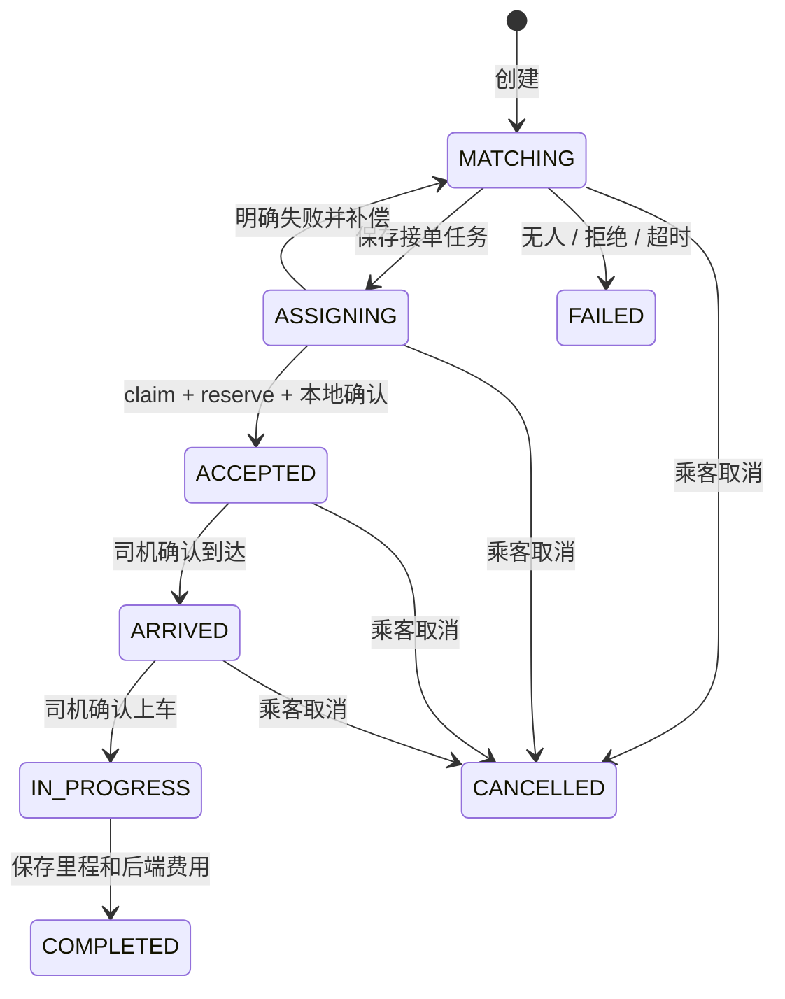

# 服务内部 API、订单事件与恢复契约

本契约对应当前 Lab 3 实现，不沿用 Lab 2 尚未实现的 gRPC / Kafka / 支付协议。公开入口以 [OpenAPI 3.0 JSON](openapi.json) 为准。内部接口不会经 Gateway 暴露；所有请求需要 `X-Internal-Token`，其值由环境配置统一提供。

## 1. 基本约定

- URL 中的 ID 为不透明字符串；数据库业务主键通常由前缀和 UUID 组成。
- 时间使用 UTC ISO 8601 字符串；前端按 Asia/Shanghai 显示。金额为整数分，距离为整数米。
- `X-Request-ID` 从网关透传；订单、任务和事件日志同时带 `order_id` / `aggregate_id`，便于跨服务关联。
- 统一错误：`{"error":{"code":"DRIVER_BUSY","message":"司机已有正在承接的订单"},"request_id":"..."}`。
- `400` 输入不合法；`401` 身份无效；`403` 越权；`404` 资源不存在；`409` 状态或资源冲突；`503` 依赖调用失败、需按原操作标识重试。
- 公开接单接口可能返回 `202` 和 `ASSIGNING`，表示请求已受理、确认未完成。若司机离线 / 已忙，Order 会补偿并返回 `200` 和 `MATCHING`、`last_assignment_failure`，此时不能解释成接单成功。前端按 `order.status` 展示结果。

## 2. 同步 API 清单

| 提供方 | 方法与路径（不带 `/api`） | 请求 / 返回 | 幂等与失败语义 |
| --- | --- | --- | --- |
| Pricing | `GET /internal/estimates/:id` | 返回 `{estimate}` | 过期报价仍可读；Order 创建时检查所属乘客和有效期 |
| Pricing | `POST /internal/fare` | `{estimate_id,distance_m}` → `{distance_m,amount_cents,rule}` | 无资金副作用；当前实现费率是不可配置常量；报价过期不妨碍已创建行程结算 |
| Driver | `GET /internal/drivers` | 返回 `{drivers:[...]}` | 档案包含 online、active_order_id、active_assignment_id |
| Driver | `GET /internal/drivers/:id` | 返回 `{driver}` | Order Query 组合查询的真实资料来源 |
| Driver | `POST /internal/drivers/:id/reserve` | `{order_id,assignment_id}` → `{driver,reserved:true}` | 同一标识重试成功；标识绑定司机 / 订单；已释放、离线或忙返回 409 |
| Driver | `POST /internal/drivers/:id/release` | `{order_id,assignment_id}` → `{driver,released:true}` | 保存 RELEASED 墓碑，仅清除匹配的当前占用；旧释放不影响新绑定 |
| Dispatch | `GET /internal/offers/:id` | 返回 `{offer}`，含原订单快照与起终点 | Order 接单前核对真实派单归属 |
| Dispatch | `POST /internal/offers/:id/claim` | `{order_id,driver_id,assignment_id}` → `{offer,claimed:true}` | PENDING 且未到期才可首次认领；同 assignment 的 CLAIMED / ACCEPTED 可重复确认 |
| Dispatch | `POST /internal/offers/:id/resolve` | `{assignment_id,status:"FAILED"或"ACCEPTED"}` → `{offer,resolved:true}` | 只关闭本标识认领；终态任务不复活；不属于本标识返回 409 |
| Order | `GET /internal/orders/:id` | 返回 `{order}` | 仅内部诊断 / 实现协作，不供查询服务回查写模型 |
| Order | `POST /internal/orders/:id/accept` | `{driver_id,offer_id}` → `{order}` | 同派单重复操作返回当前结果；创建持久化 Saga 后执行 claim / reserve |
| Order | `POST /internal/orders/:id/fail-matching` | `{reason}` → `{order}` | 只允许 MATCHING → FAILED；重复 FAILED 成功；ASSIGNING 等阶段返回 409 |
| Order | `GET /internal/diagnostics` | `{pending_jobs,pending_events}` | 列出恢复次数和末次错误，不包含令牌 |
| Query / Dispatch | `POST /internal/events` | 完整订单事件 → 投影处理结果 | Inbox 去重和读模型更新在同一本地事务 |

`reason` 为 `NO_DRIVER`、`ALL_REJECTED`、`MATCH_TIMEOUT`、`ALL_UNAVAILABLE` 之一；当前顺序派单使用前三项。后台 worker 对服务暂不可用保留持久化任务，并稍后继续。

## 3. 订单状态与命令



Order 为状态裁决唯一权威。开始后普通取消被拒绝。重复到达、开始、结束在首次有效操作已发生时返回当前聚合，首次时间与费用不重写，不回退到先前状态。每次真正变更都递增 `version`，与状态日志和 Outbox 共同提交。

## 4. 异步订单事件

事件类型：`order.created.v1` 与 `order.changed.v1`。相同订单的版本从 1 单调递增；投递至 Query 和 Dispatch 两个目标，各自维护投递状态。

```json
{
  "event_id": "evt_<uuid>",
  "event_type": "order.changed.v1",
  "aggregate_id": "ord_<uuid>",
  "version": 3,
  "occurred_at": "2026-11-15T10:00:00.000Z",
  "trace_id": "ord_<uuid>",
  "data": {
    "id": "ord_<uuid>",
    "rider_id": "rider-1",
    "status": "ACCEPTED",
    "version": 3,
    "driver_id": "driver-1",
    "pending_driver_id": null,
    "offer_id": "offer_<uuid>",
    "assignment_id": "asg_<uuid>",
    "origin": {"id":"fudan","name":"复旦大学邯郸校区","lat":31.2989,"lng":121.5033},
    "destination": {"id":"bund","name":"外滩","lat":31.24,"lng":121.49},
    "estimate": {"id":"estimate_<uuid>","rider_id":"rider-1","distance_m":8670,"amount_cents":2618},
    "created_at": "2026-11-15T09:59:55.000Z",
    "updated_at": "2026-11-15T10:00:00.000Z",
    "accepted_at": "2026-11-15T10:00:00.000Z",
    "arrived_at": null,
    "started_at": null,
    "finished_at": null,
    "cancelled_at": null,
    "final_distance_m": null,
    "final_amount_cents": null,
    "failure_reason": null
  }
}
```

以上报价对象为字段节选；实际 `data` 是订单完整快照，`estimate` 含公开契约中的起终点、费率、期限等字段。使用完整快照而非差量，允许接收方跳过缺失版本，直接应用较新事实。

1. 订单写入与每个目标的 Outbox 行在一个 SQLite `BEGIN IMMEDIATE` 事务提交。没有“订单保存了但忘了记录待发事件”的窗口。
2. worker 在事务提交后异步 HTTP 投递，成功才设置 `delivered_at`。接收端提交后若响应丢失，发送端重投同一个 `event_id`。
3. Query / Dispatch 在本地事务检查 Inbox，并仅更新 `incoming.version > local.version` 的快照；重复和旧版本不覆盖新状态。Inbox 与投影共同提交，退出后可安全重试。
4. 重试从 250ms 起按指数增加，最多间隔 10 秒，不丢弃未完成行。每个目标独立，Query 停机不阻断 Dispatch 的事件更新。
5. 无全局跨服务事务、无跨库查询、无独立消息代理。保证成立的条件是本地持久化介质保留、相关服务最终恢复；长期不可用时可在诊断接口查看积压。

## 5. 接单与释放恢复任务

| 任务 | 持久化时机 | 执行与重复语义 |
| --- | --- | --- |
| `RESERVE_DRIVER` | Order 进入 ASSIGNING 的同一事务 | 用固定 assignment_id 认领派单、占用司机，再检查订单仍处于本次 ASSIGNING 才确认 ACCEPTED |
| `RELEASE_DRIVER` | 取消 / 完成，或 Saga 补偿的同一事务 | 向 Driver 释放原 order_id + assignment_id；即使 reserve 尚未到达，先写墓碑也能阻止迟到占用 |
| `RESOLVE_OFFER` | 接单确认 / 补偿的同一事务 | 关闭对应派单认领；404 / 409 / 410 表示资源已不可更改，可结束该通知任务，不修改其他认领 |

任务记录包含 type、order_id、payload、status、attempts、next_attempt_at、last_error、created_at、finished_at。重启扫描 PENDING 且到期任务。保留同一 assignment_id，不能通过重试创建另一个逻辑占用。取消与确认竞争时，确认的本地 CAS 不能越过 CANCELLED，随后确保存在原占用的释放任务。

## 6. 查询延迟与组合降级

`GET /api/orders/:id?min_version=N` 只读取 Query 自有投影。当本地版本不足时返回 `202`、`sync_pending=true`，不伪造新状态，也不访问 Order 写库。前端保存命令响应的权威版本，显示同步提示并继续查询；任何较旧版本不覆盖已有较新状态。

有 `driver_id` 的详情通过 Driver API 查询实时资料再组合。Driver 不可用时返回 `200`、原订单、`driver=null`、`partial=true` 和 `warnings`，使订单状态可读。驱动派单、接单和状态修改仍由各写服务按权限校验；查询降级不放宽业务写入规则。
